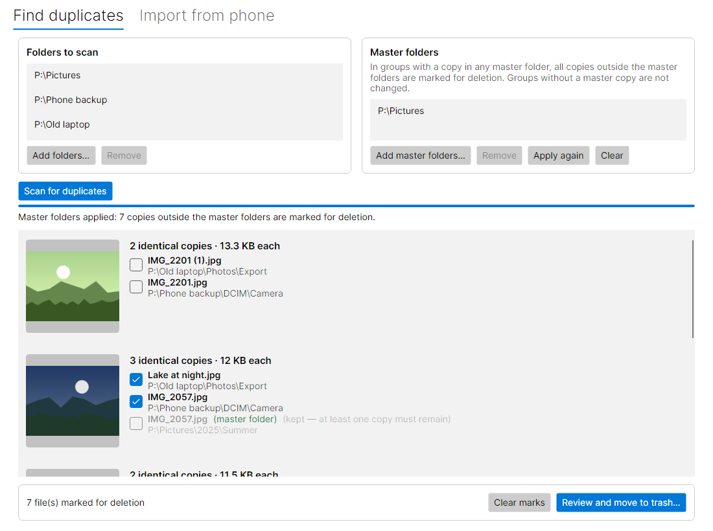
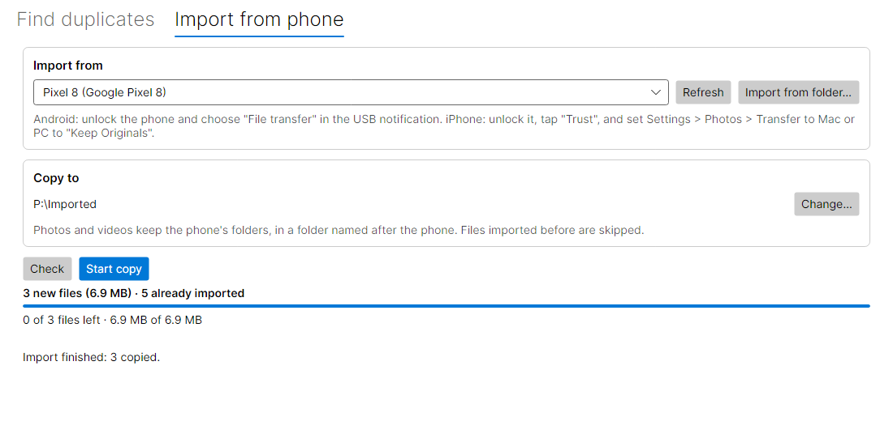

# PhotoSift

Cross-platform desktop app (.NET 10, Avalonia) that finds exact duplicate photos in local folders and safely moves selected copies to the OS trash. See [SPEC.md](SPEC.md) for requirements.



_Screenshots show generated demo images._

## Run

Requires the .NET 10 SDK. From the repository root:

```sh
dotnet run --project src/PhotoSift.Desktop
```

(Plain `dotnet run` only works from inside `src/PhotoSift.Desktop`; the repository root contains the solution, not a runnable project.)

## Build and test

```sh
dotnet build PhotoSift.sln
dotnet test PhotoSift.sln
```

## Download

Prebuilt apps for Windows, macOS, and Linux are on the [Releases page](https://github.com/ChiliMonanta/photo-sift/releases). They are not code-signed yet; each release explains how to open the app the first time.

## Making a release

1. Make sure `main` is green and contains everything for the release.
2. Tag and push (use a suffix such as `-rc.1` for a pre-release):
   ```sh
   git tag v0.1.0
   git push origin v0.1.0
   ```
3. The [Release workflow](.github/workflows/release.yml) runs the tests, builds all platforms, and creates a **draft** release with the packages, checksums, and generated notes.
4. Review the draft on GitHub and click **Publish release**.

To try the packaging without releasing, run the Release workflow manually from the Actions tab; the packages are attached to the run as artifacts.

## Import from phone

The **Import from phone** tab copies photos and videos from an Android phone or iPhone (Windows), or from any folder such as a memory card. Connect the phone with a USB cable and unlock it (Android: choose "File transfer"; iPhone: tap "Trust" and set Settings > Photos > Transfer to Mac or PC to "Keep Originals"), click **Refresh**, choose the phone, and click **Start copy**.

Nothing on the phone is changed. Files imported before are skipped, and if the import is interrupted, clicking **Start copy** again continues where it stopped; a file whose copy was cut off is copied again, so no broken files are left behind.



## Sort photos

The **Sort photos** tab shows the folders in your photo folder and the photos in the selected folder. Create a folder, select photos, choose the folder under **Move selected to**, and click **Move**. Nothing is overwritten (a taken name gets a number), files are only moved within the same drive, and **Undo last move** puts the photos back.

## Google Drive (in development)

PhotoSift can scan folders in your own My Drive, read-only, together with local folders, and upload photos to Drive (Windows only for now). Click **Connect Google Drive…**, sign in in your browser, then **Browse Google Drive…** to add Drive folders to scan or as master folders. Hashes come from Drive's metadata, so no photos are downloaded. Drive copies are never moved to the trash in this version, but they count as kept copies when you delete local duplicates.

The **Upload to Google Drive** tab uploads the photos and videos in a local folder to a Drive folder you choose, keeping the local folders. Photos whose contents are already anywhere in that Drive folder are skipped, and an interrupted upload continues where it stopped. A good order is: import from the phone, remove duplicates, then upload. Nothing in Google Drive is changed or deleted.

Google Drive support needs a Google OAuth client. The credentials are not in this repository; to build with Drive support (for example in a fork), create your own client by following [docs/google-oauth-setup.md](docs/google-oauth-setup.md).
